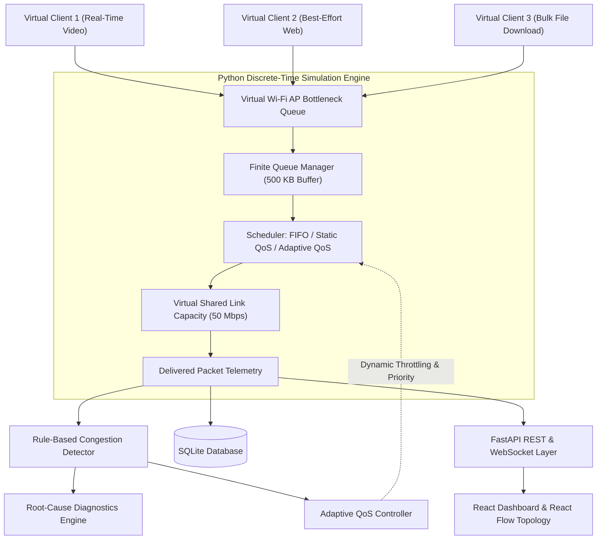

# Adaptive Wi-Fi Congestion Detection and QoS-Based Performance Optimization Using Network Simulation

A full-stack, software-based Computer Networks simulation project modeling wireless link contention, queue buffer dynamics, congestion detection, and Quality of Service (QoS) scheduling policies.

> **Important Simulation Disclaimer:**  
> This project is a **software-based discrete-time network simulation**. All measurements, packet queues, contention dynamics, and delays are computed deterministically in Python. No physical routers, external wireless NICs, hardware testbeds, or real network traffic (such as iPerf3) are used or required.

---

## 1. Project Overview & Objective

In shared wireless local area networks (WLANs), diverse applications compete for limited radio channel capacity:
1. **Real-time traffic** (interactive video conferencing, telehealth, VoIP, online classes) which is highly sensitive to packet latency and jitter.
2. **Best-effort traffic** (HTTP web browsing, general cloud services).
3. **Bulk traffic** (large file transfers, OS updates, P2P file sharing) which saturates available link capacity.

Under high load without Quality of Service (QoS), large bulk packets fill router buffers (causing **Bufferbloat**), inducing high queueing delays and packet loss (tail drops) across interactive sessions.

This project implements:
- A custom **Python discrete-time network simulation engine** with micro-slice interleaved packet arrival, queueing, and transmission.
- A **Rule-based Congestion Detector** with moving-average filtering, state transitions (`NORMAL`, `WARNING`, `CONGESTED`, `RECOVERING`), and hysteresis cooldowns.
- An **Explainable Root-Cause Diagnostic Engine** identifying overload, bufferbloat, tail drops, bulk starvation, and QoS inadequacy.
- Three QoS scheduling strategies:
  - **Mode A: Baseline FIFO** (Neutral First-In First-Out)
  - **Mode B: Static QoS** (Strict Priority Queueing: Real-Time > Best-Effort > Bulk)
  - **Mode C: Adaptive QoS** (Dynamic congestion feedback controller with rate limiting and headroom guarantees)
- A **React + Tailwind CSS dashboard** with interactive React Flow topology, Recharts time-series performance graphs, controlled 3-way experiment benchmarking, SQLite persistence, and CSV export.

---

## 2. Technology Stack

- **Simulation Core & Backend**:
  - Python 3.10+ / 3.14
  - FastAPI (REST API & WebSocket support)
  - Pydantic v2 (Data validation & schemas)
  - SQLAlchemy & SQLite (Persistent database storage)
  - Uvicorn (ASGI development web server)
  - Pytest (Automated unit and integration test suite)
- **Frontend & Visualization**:
  - React 19 + Vite
  - Tailwind CSS v4 (Modern technical dark/cyber design system)
  - `@xyflow/react` (Interactive network topology canvas)
  - `Recharts` (Time-series performance charts)
  - `Lucide React` (Technical network iconography)

---

## 3. Architecture Overview



---

## 4. Metric Definitions & Formulas

All metrics in this application are calculated deterministically:

| Metric | Definition & Mathematical Formula | Units | Behavior at Zero Traffic |
| :--- | :--- | :--- | :--- |
| **Delivered Throughput** | Successfully transmitted payload bits divided by measurement interval: $\frac{\sum \text{Bytes Delivered} \times 8}{\Delta t \times 10^6}$ | Mbps | `0.0 Mbps` |
| **Simulated Latency** | Sum of queue dwell time, base wireless propagation, and transmission delay: $T_{\text{queue}} + T_{\text{prop}} + \frac{\text{Packet Size} \times 8}{C_{\text{bps}}}$ | Milliseconds (ms) | Nominal base delay `5.0 ms` |
| **P95 Latency** | 95th percentile value from the sorted distribution of delivered packet delays within the measurement window. | Milliseconds (ms) | Equals average delay |
| **Jitter** | RFC 3393 inter-packet delay variation: Arithmetic mean of consecutive packet transit time differences: $\|D_i - D_{i-1}\|$ | Milliseconds (ms) | `0.0 ms` |
| **Packet Loss %** | Total dropped packets (tail drop or buffer clamp) divided by generated packets: $\frac{\text{Dropped Packets}}{\text{Generated Packets}} \times 100\%$ | Percentage (%) | `0.0%` (strictly bounded 0–100%) |
| **Bandwidth Utilization** | Transmitted throughput relative to configured bottleneck link capacity: $\frac{\text{Delivered Throughput}}{\text{Bottleneck Capacity}} \times 100\%$ | Percentage (%) | `0.0%` (capped at 100%) |
| **Queue Occupancy** | Total buffered bytes currently residing in AP queues relative to finite buffer capacity: $\frac{\text{Current Queue Bytes}}{\text{Buffer Capacity Bytes}} \times 100\%$ | Percentage (%) | `0.0%` |
| **Congestion Duration** | Accumulated simulated seconds during which the detector remained in the `CONGESTED` state. | Seconds (s) | `0.0s` |

---

## 5. QoS Scheduling Algorithms

### Mode A: Baseline FIFO
- All packets enter a single shared queue in arrival order.
- Dequeued strictly First-In, First-Out up to available capacity per time step.
- Under heavy load, large bulk packets monopolize buffer space, forcing interactive video packets to endure maximum queueing delay and tail drops.

### Mode B: Static QoS (Strict Priority Queueing)
- Three isolated queues: Queue 0 (Real-Time), Queue 1 (Best-Effort), Queue 2 (Bulk).
- Packets are served in strict order: Real-Time is drained completely first, followed by Best-Effort, then Bulk.
- Real-Time packets experience virtually 0 ms queueing wait even when Bulk traffic overloads the link.

### Mode C: Adaptive QoS (Congestion-Feedback Controller)
- **Normal State**: Balanced fair allocation allowing bulk downloads to utilize full unallocated bandwidth.
- **Congested State Trigger**: When moving-average utilization $\ge 95\%$ or buffer occupancy $\ge 70\%$ or loss $\ge 3\%$:
  - Real-Time flows receive guaranteed 100% priority headroom.
  - Bulk transfers are capped to a maximum of 20% of bottleneck link capacity.
  - Active Queue Management (AQM) limits bulk buffer depth to 35% of total buffer space to prevent bufferbloat.
- **Recovery & Cooldown**: Requires 10 consecutive uncongested steps before entering `NORMAL`, followed by a 15-step hysteresis cooldown to prevent policy oscillation.

---

## 6. Congestion Detection & State Machine

```
              Overload Detected (2 steps)
    [ NORMAL ] --------------------------> [ CONGESTED ]
        ^                                        |
        |                                        | Metrics drop below
        | Sustained for 10 steps                 | thresholds
        |                                        v
        +--------------------------------- [ RECOVERING ]
```

1. **`NORMAL`**: Monitored metrics within nominal limits.
2. **`WARNING`**: Utilization $\ge 85\%$ or queue occupancy $\ge 40\%$. Early warning indication.
3. **`CONGESTED`**: Severe condition requiring active intervention.
4. **`RECOVERING`**: Verification phase ensuring link stability before lifting restrictions.

---

## 7. Installation & Startup Instructions

### Prerequisites
- Python 3.10+ (tested on Python 3.14)
- Node.js v18+ & npm (tested on Node v24)

### Step 1: Clone and Enter Directory
```bash
git clone <repo-url>
cd cn-case-study
```

### Step 2: Backend Setup
```bash
cd backend
python -m venv venv

# Windows:
.\venv\Scripts\activate
# Linux / macOS:
# source venv/bin/activate

pip install -r requirements.txt
cd ..
```

### Step 3: Frontend Setup
```bash
cd frontend
npm install
cd ..
```

---

## 8. Launching the Application

### Option A: One-Click Startup Script (Windows PowerShell)
```powershell
.\start.ps1
```

### Option B: One-Click Startup Script (Linux / macOS Bash)
```bash
chmod +x start.sh
./start.sh
```

### Option C: Manual Terminal Launch

**Terminal 1 (Backend):**
```bash
cd backend
.\venv\Scripts\activate      # or source venv/bin/activate
python -m uvicorn app.main:app --host 127.0.0.1 --port 8000 --reload
```

**Terminal 2 (Frontend):**
```bash
cd frontend
npm run dev
```

Open your browser to:
- **Frontend Dashboard**: [http://localhost:5173](http://localhost:5173)
- **Backend API Documentation**: [http://localhost:8000/docs](http://localhost:8000/docs)
- **Backend Health Check**: [http://localhost:8000/api/health](http://localhost:8000/api/health)

---

## 9. Running Automated Tests

A comprehensive Pytest suite validates all 14 required cases (no traffic, low load, overload, tail drops, static QoS, adaptive QoS, recovery, cooldown, repeatability, metric bounds, comparison workflow, and persistence).

To run tests:
```bash
cd backend
.\venv\Scripts\python.exe -m pytest
```

Expected output:
```
tests/test_api.py ....                                                   [ 25%]
tests/test_simulation.py ............                                    [100%]
======================= 16 passed in 1.6s =======================
```

---

## 10. Step-by-Step Demonstration for Presentations

1. **Open the Dashboard**: Navigate to `http://localhost:5173`.
2. **Observe Baseline FIFO Under Congestion**:
   - In **Simulation Controls**, select the **High Load** preset (offering ~82 Mbps against a 50 Mbps bottleneck).
   - Ensure **Mode A: Baseline FIFO** is selected.
   - Click **Start Simulation**.
   - Navigate to **Network Topology**: Observe links turning red, AP queue filling up to 100%, and client cards showing packet loss.
   - Switch to **Performance Analytics**: Observe Real-Time video latency climbing from 5 ms up to 40–80 ms and suffering severe packet loss because bulk downloads fill the FIFO buffer.
3. **Observe Static QoS Protection**:
   - Click **Reset**, switch to **Mode B: Static QoS**, and click **Start**.
   - Notice how Real-Time video latency stays consistently flat at ~5 ms with 0% packet loss, as video packets are served first.
4. **Observe Mode C: Adaptive QoS Dynamic Response**:
   - Switch to **Mode C: Adaptive QoS** and run the simulation.
   - Switch to **Congestion & Root Causes**: Watch the detector transition from `NORMAL` $\to$ `WARNING` $\to$ `CONGESTED`.
   - Inspect the **Explainable Root-Cause Hypotheses**: Review the diagnosis highlighting bulk traffic starvation and link overload.
   - Switch to **QoS Controller**: Observe the transition log where the adaptive controller automatically throttles bulk traffic to 20%, draining the queue and restoring video quality.
5. **Execute Controlled 3-Way Benchmark**:
   - Go to the **Experiment Comparison** tab.
   - Click **Run Controlled Benchmark**.
   - Inspect the side-by-side comparison matrix demonstrating the exact percentage latency improvements achieved by Static and Adaptive QoS.
6. **Export Data**:
   - Go to **Saved Runs** and click **Export Telemetry CSV** to verify persistence in SQLite and CSV export.

---

## 11. REST API Reference

| Method | Endpoint | Description |
| :--- | :--- | :--- |
| `GET` | `/api/health` | Backend service health and version check |
| `GET` | `/api/config` | Get current simulation and threshold configuration |
| `PUT` | `/api/config` | Update bottleneck bandwidth, queue limits, duration, or preset |
| `POST` | `/api/simulation/start` | Start or resume simulation loop |
| `POST` | `/api/simulation/pause` | Pause simulation loop |
| `POST` | `/api/simulation/resume` | Resume paused simulation |
| `POST` | `/api/simulation/stop` | Terminate running simulation |
| `POST` | `/api/simulation/reset` | Reset simulation state to step 0 |
| `GET` | `/api/simulation/status` | Current step index, simulation time, mode, and state |
| `GET` | `/api/metrics/current` | Telemetry from the most recent simulation step |
| `GET` | `/api/metrics/history` | Full time-series metrics history |
| `GET` | `/api/topology` | React Flow topology nodes, edges, and congestion states |
| `GET` | `/api/congestion/events` | Log of congestion detector state transitions |
| `GET` | `/api/congestion/diagnostics` | Explainable root-cause diagnosis reports |
| `GET` | `/api/qos/status` | Current QoS policy controller state and parameters |
| `GET` | `/api/qos/history` | Log of QoS policy changes and reasons |
| `POST` | `/api/experiments/run-comparison` | Run Baseline vs Static vs Adaptive comparison |
| `GET` | `/api/experiments` | List saved runs from SQLite database |
| `GET` | `/api/experiments/{id}` | Detailed telemetry snapshots for a saved run |
| `GET` | `/api/experiments/{id}/export` | Download time-series telemetry as CSV file |
| `WS` | `/ws/simulation` | WebSocket stream for real-time simulation telemetry |

---

## 12. Simulation Assumptions & Technical Modeling

### Behaviors Accurately Modeled:
- Discrete-time link capacity sharing and bandwidth saturation.
- Finite queue limits (buffer size in bytes) with tail drops.
- Queueing delay calculated based on buffer dwell time ($T_{\text{dequeued}} - T_{\text{enqueued}}$).
- Micro-slice interleaved arrival and transmission preventing discrete-time batch artifacts.
- Deterministic pseudo-random packet arrival with seed configuration.
- Hysteresis and moving-average smoothing for congestion signals.

### Wi-Fi Behaviors Approximated / Omitted:
- 802.11 CSMA/CA binary exponential backoff is modeled via an aggregate contention delay rather than bit-level PHY slot collisions.
- Wireless channel is assumed to have uniform signal-to-noise ratio across clients without multipath fading or shadowing.
- Frame aggregation (A-MPDU) and MIMO spatial streams are approximated into effective bottleneck capacity rather than discrete PHY frame preambles.
