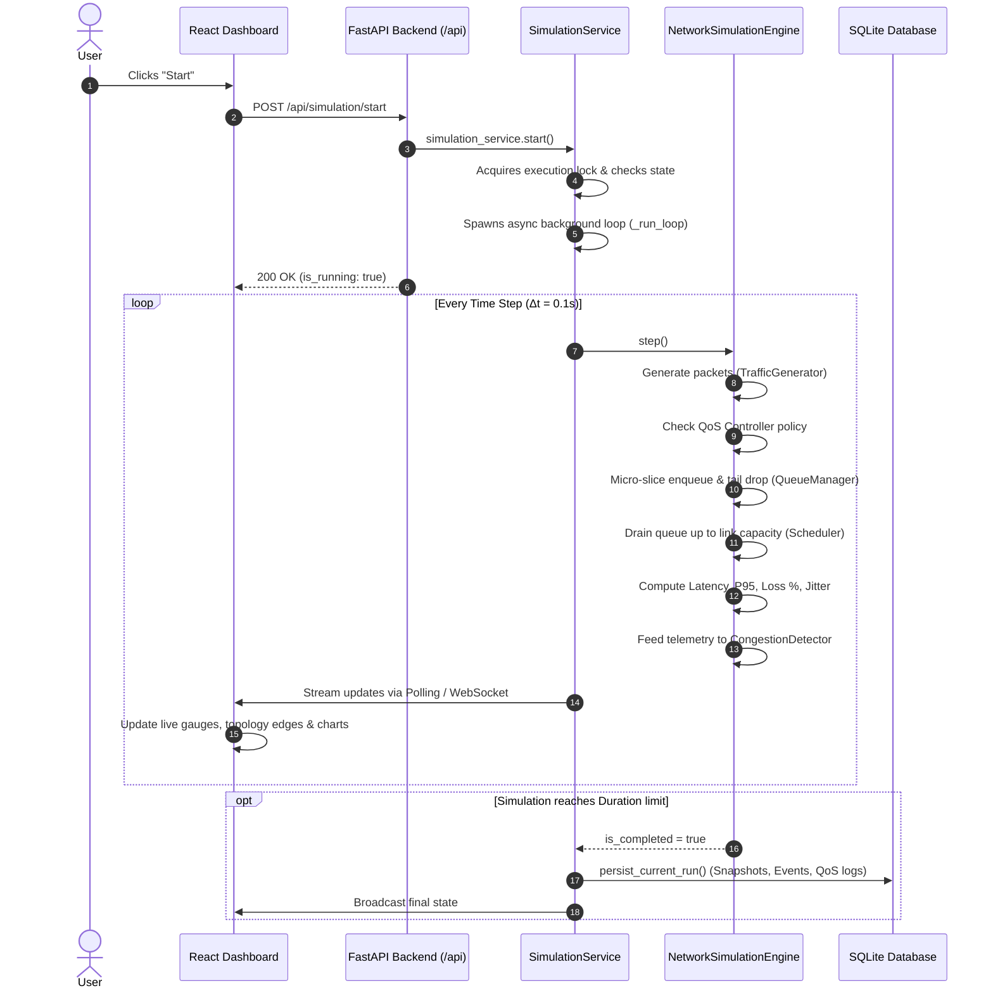
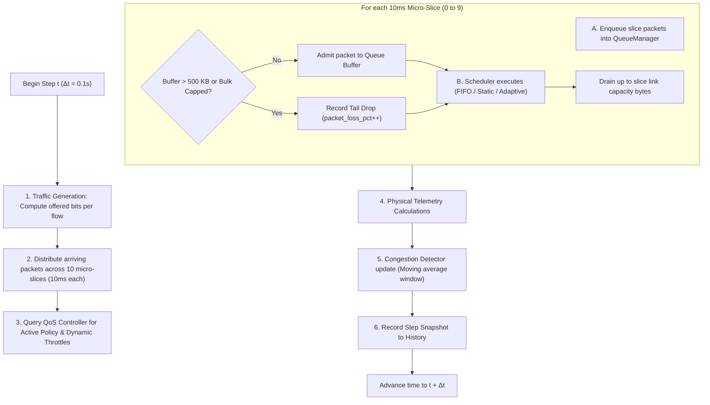

# Comprehensive Technical Guide: Simulation Architecture, Parameters, Modes & Visualizations

This document provides an end-to-end technical explanation of how the **Adaptive Wi-Fi Congestion Detection & QoS Simulation Platform** works. It covers the complete lifecycle of a simulation run from the moment the user clicks **Start**, breaks down every configurable parameter, details the mathematical and algorithmic operation of each QoS mode, explains the live network topology, and details how every chart interprets simulation telemetry.

---

## Table of Contents
1. [What Happens When the User Clicks "Start"](#1-what-happens-when-the-user-clicks-start)
2. [Simulation Engine Execution Cycle (Under the Hood)](#2-simulation-engine-execution-cycle-under-the-hood)
3. [Explanations of Every Parameter](#3-explanations-of-every-parameter)
4. [Deep Dive into the Three QoS Modes](#4-deep-dive-into-the-three-qos-modes)
5. [The Live Network Topology Diagram (React Flow)](#5-the-live-network-topology-diagram-react-flow)
6. [Explanation of Every Performance Graph](#6-explanation-of-every-performance-graph)
7. [Congestion Detector & Root-Cause Diagnostic System](#7-congestion-detector--root-cause-diagnostic-system)
8. [Controlled 3-Way Experiment Benchmark](#8-controlled-3-way-experiment-benchmark)

---

## 1. What Happens When the User Clicks "Start"

When the user clicks the green **"Start"** button on the dashboard navbar:



### Detailed Event Sequence:
1. **Frontend Request**: The React hook (`useSimulation.js`) issues a `POST /api/simulation/start` HTTP request.
2. **Concurrency Protection**: In `SimulationService`, an `asyncio.Lock` ensures only one background worker task runs at any time, preventing race conditions or corrupted metrics.
3. **Async Event Loop**: An asynchronous task (`_run_loop`) starts running in the background at real-time pacing (spaced by $\Delta t = 100\,\text{ms}$).
4. **Iterative Stepping**: Each iteration invokes `engine.step()`, computing realistic packet arrivals, queue buffers, and link transmissions.
5. **Real-Time Telemetry Broadcasting**: At each step, metrics are packaged and pushed over WebSocket `/ws/simulation` and made available to polling endpoints (`/api/simulation/status` and `/api/metrics/history`).
6. **Automatic Persistence**: When simulated time reaches the configured `duration_seconds` (e.g. 30s), the background loop stops and commits an `ExperimentModel` with all per-step snapshots to the local SQLite database.

---

## 2. Simulation Engine Execution Cycle (Under the Hood)

The simulation engine is implemented as a **discrete-time network simulation with micro-slice interleaving**. Rather than treating the 100 ms interval as a single instantaneous batch (which would cause artificial burst drops), each step is subdivided into **10 micro-slices of 10 ms each**.



### The Math Computed in Every Step:
1. **Offered Bits**:
   $$\text{Offered Bytes} = \frac{\text{Offered Load (Mbps)} \times 10^6 \times \Delta t}{8} \times \text{Variance}$$
   Where $\text{Variance}$ is a small deterministic PRNG fluctuation simulating realistic packet inter-arrival jitter.
2. **Queueing Delay & Simulated Latency**:
   For every delivered packet:
   $$T_{\text{queue}} = T_{\text{dequeued}} - T_{\text{creation}}$$
   $$T_{\text{transmission}} = \frac{\text{Packet Size (Bytes)} \times 8}{C_{\text{bps}}}$$
   $$T_{\text{total delay}} = T_{\text{queue}} + T_{\text{propagation}} (5.0\,\text{ms}) + T_{\text{transmission}}$$
3. **RFC 3393 Jitter**:
   $$\text{Jitter}_i = |T_{\text{delay}, i} - T_{\text{delay}, i-1}|$$
4. **Packet Loss Percentage**:
   $$\text{Loss } \% = \frac{\sum \text{Dropped Packets}}{\sum \text{Generated Packets}} \times 100\%$$
5. **Bandwidth Utilization Percentage**:
   $$\text{Utilization } \% = \min\left(100\%, \frac{\text{Delivered Throughput (Mbps)}}{\text{Bottleneck Capacity (Mbps)}} \times 100\%\right)$$

---

## 3. Explanations of Every Parameter

| Parameter | Default Value | Technical Meaning & Impact on the Network |
| :--- | :--- | :--- |
| **Bottleneck Capacity (`bottleneck_capacity_mbps`)** | `50.0 Mbps` | The maximum bandwidth capacity of the shared virtual Wi-Fi AP uplink. If total offered load across all clients exceeds this value, congestion occurs and queues will build up. |
| **Queue Capacity (`queue_capacity_bytes`)** | `500,000 Bytes` ($500\,\text{KB}$) | The physical hardware buffer depth on the Access Point. A larger buffer delays packet drops but causes **Bufferbloat** (high latency). A smaller buffer keeps latency low but triggers frequent tail drops. |
| **Simulation Duration (`duration_seconds`)** | `30.0 s` | Total virtual runtime of the experiment. Once this simulated time elapsed, the run automatically terminates and archives to the database. |
| **Time Step (`time_step_seconds`)** | `0.1 s` ($100\,\text{ms}$) | The granularity of the simulation clock. 10 discrete steps represent 1 second of virtual network time. |
| **PRNG Random Seed (`random_seed`)** | `42` | The seed for the pseudo-random number generator. Using the exact same seed across runs guarantees **100% deterministic repeatability** for scientific comparisons. |
| **Warning Utilization Threshold** | `85.0%` | If moving-average bandwidth utilization reaches $85\%$, the detector transitions from `NORMAL` to `WARNING`. |
| **Congestion Utilization Threshold** | `95.0%` | If moving-average link utilization reaches $95\%$, the detector flags potential saturation. |
| **Congestion Queue Threshold** | `70.0%` | If the AP buffer fills beyond $70\%$ capacity, the detector triggers a `CONGESTED` state due to imminent buffer overflow. |
| **Congestion Packet Loss Threshold** | `3.0%` | If packet loss exceeds $3\%$, severe congestion is declared regardless of utilization. |
| **Adaptive Recovery Steps** | `10 steps` ($1.0\,\text{s}$) | The number of consecutive clean steps required before the adaptive controller is permitted to downgrade from `RECOVERING` back to `NORMAL`. |
| **Adaptive Cooldown Steps** | `15 steps` ($1.5\,\text{s}$) | Hysteresis timer that locks the controller after recovery, preventing rapid back-and-forth oscillation between policies. |
| **Bulk Rate Limit Share** | `0.20` ($20\%$) | In Mode C (Adaptive QoS), when congestion is active, the bulk traffic queue is dynamically throttled to at most $20\%$ of the bottleneck link capacity ($10\,\text{Mbps}$ on a $50\,\text{Mbps}$ link). |

---

## 4. Deep Dive into the Three QoS Modes

### Mode A: Baseline — No Special QoS (FIFO)
- **Queue Structure**: A single unified FIFO queue shared by all flows regardless of traffic class.
- **Service Policy**: Packets are dequeued strictly in order of arrival ($F_0, F_1, F_2, \dots$).
- **Behavior Under Overload**:
  - Bulk transfers generate large $1500\,\text{B}$ packets that quickly consume all $500\,\text{KB}$ of buffer space.
  - Interactive video packets ($250\,\text{B}$) arrive and must sit behind hundreds of bulk packets.
  - Real-time video latency climbs from $5\,\text{ms}$ up to **$134\text{–}150\,\text{ms}$**.
  - When the queue fills to $100\%$, incoming video packets suffer random **tail drops**, causing video freezing and call degradation.

### Mode B: Static QoS (Strict Priority Queueing)
- **Queue Structure**: Three physically isolated queues:
  1. `Queue 0`: Real-Time (Priority 1 — High)
  2. `Queue 1`: Best-Effort (Priority 2 — Medium)
  3. `Queue 2`: Bulk (Priority 3 — Low)
- **Service Policy**:
  - In every micro-slice, the scheduler drains `Queue 0` first until empty or link capacity is reached.
  - If bandwidth remains, it drains `Queue 1`.
  - Only if bandwidth still remains does it drain `Queue 2` (Bulk).
- **Behavior Under Overload**:
  - Real-time video packets never wait behind bulk transfers.
  - Real-time video latency stays flat at **$5.0\,\text{ms}$** with **$0.0\%$ packet loss**.
  - Bulk traffic absorbs all packet drops and queue delay.

### Mode C: Adaptive QoS (Congestion-Feedback Controller)
- **Motivation**: While Static QoS protects video, under varying traffic conditions it can permanently starve low-priority tasks even when congestion is mild. Adaptive QoS provides dynamic, closed-loop control.
- **Normal State**: Functions with fair dynamic sharing, allowing bulk downloads to burst up to 100% of link capacity when the link is idle.
- **Congested State (Active Intervention)**:
  - When the detector flags `CONGESTED` (e.g. utilization $\ge 95\%$ or queue $\ge 70\%$ for 2 consecutive steps):
  - **Dynamic Bulk Throttling**: Caps bulk traffic to $\le 20\%$ of bottleneck capacity ($10\,\text{Mbps}$).
  - **Active Queue Management (AQM Buffer Clamp)**: Enforces a ceiling on bulk buffer occupancy (maximum $35\%$ of buffer space), actively preventing bulk packets from bloating the AP buffer.
  - **Guaranteed Real-Time Headroom**: Allocates 100% service reservation for real-time video flows.
- **Outcome**: Average buffer occupancy drops from **$87.5\%$ down to $34.4\%$**, real-time latency drops immediately back to **$5.0\,\text{ms}$**, and once load subsides, full bulk bandwidth is automatically restored after the recovery and cooldown intervals.

---

## 5. The Live Network Topology Diagram (React Flow)

The canvas on the **Network Topology** tab represents the simulated Wi-Fi Collision Domain:

```
                  [ Congestion Detector Agent ]
                                ^
                                | Telemetry Link
                                v
               +----------------------------------+
               |  Virtual Wi-Fi AP / Router Node  |
               +----------------------------------+
                     ^          ^          ^
                     |          |          | Wireless Contention Links
          +----------+          |          +----------+
          |                     |                     |
   [ Client 1 (RT) ]     [ Client 2 (BE) ]     [ Client 3 (Bulk) ]
      (Zoom Call)          (Web Browsing)        (Large Download)
```

### Visual Indicators & States:
1. **Virtual Wi-Fi AP / Router (Center Node)**:
   - Displays real-time **bottleneck capacity**, **aggregate delivered throughput**, **utilization percentage**, and **queue occupancy**.
   - **Normal State**: Border glows with cyan/sky accent.
   - **Congested State**: Border pulses with an intense red glow (`border-rose-500 ring-2 ring-rose-500/30`), indicating the AP buffer is experiencing tail drops.
2. **Virtual Client Nodes (Bottom Arc)**:
   - Distinct color themes by traffic category:
     - **Real-Time Flows** (Amber badge): Interactive video/voice sessions.
     - **Best-Effort Flows** (Sky blue badge): Web traffic.
     - **Bulk Flows** (Purple badge): File transfers, cloud backups.
   - Displays instantaneous offered load (e.g. `6.0 Mbps`) and red packet drop alerts if tail drops occur.
3. **Animated Traffic Links (Edges)**:
   - Connected between each client and the AP router.
   - Moving dashed particles visualize packet transmission.
   - When link utilization is high and packet loss occurs, the affected link transforms into **`edge-congested`** with a red pulsing glow.
4. **Interactive Node Inspector**:
   - Clicking any node opens a slide-over details panel displaying raw telemetry:
     - Configured load vs. delivered throughput
     - Average delay & P95 delay
     - RFC 3393 jitter
     - Exact packet drop count and tail drop reasons

---

## 6. Explanation of Every Performance Graph

All charts in the **Performance Analytics** section render real data points sampled from the Python simulation engine:

### Chart 1: Offered vs. Delivered Throughput (Mbps)
- **Gold Area (Offered Load)**: The aggregate traffic volume generated by all virtual client stations.
- **Cyan Area (Delivered Throughput)**: The payload bits successfully transmitted across the bottleneck link per second.
- **Interpretation**:
  - In an uncongested link, Delivered Throughput tracks Offered Load 1:1.
  - When Offered Load exceeds link capacity ($82\,\text{Mbps} > 50\,\text{Mbps}$), the cyan area flatlines at the physical capacity ceiling ($50\,\text{Mbps}$). The gap between the gold and cyan curves represents traffic that must be buffered or dropped.

### Chart 2: Simulated Latency (Avg & P95 in ms)
- **Green Line (Average Latency)**: Arithmetic mean of all packet delays delivered in that step.
- **Pink Dashed Line (P95 Latency)**: 95th percentile delay, measuring tail latency.
- **Interpretation**:
  - In an idle link, both stay at the base wireless delay ($5.0\,\text{ms}$).
  - Under FIFO congestion, both lines surge to $80\text{–}140\,\text{ms}$ as packets queue up.
  - Under Static or Adaptive QoS, average real-time delay remains at $5\,\text{ms}$, while P95 illustrates the controlled queueing of bulk packets.

### Chart 3: Per-Category Delivered Throughput (Mbps)
- **Amber Curve (Real-Time)**: Bandwidth consumed by video/voice flows.
- **Blue Curve (Best-Effort)**: Bandwidth consumed by web browsing.
- **Purple Curve (Bulk)**: Bandwidth consumed by large downloads.
- **Interpretation**:
  - In FIFO mode, the purple curve dominates, consuming up to $70\%$ of available bandwidth.
  - When Adaptive QoS engages, the purple curve is instantly clamped to $20\%$ ($10\,\text{Mbps}$), freeing bandwidth to clear real-time and web queues.

### Chart 4: Queue Buffer Occupancy (%) vs. Packet Loss (%)
- **Purple Gradient Area (Queue Depth)**: Percentage of the $500\,\text{KB}$ AP buffer currently filled with packets.
- **Rose Line (Packet Loss %)**: Percentage of arriving packets dropped due to buffer overflow.
- **Interpretation**:
  - When Queue Occupancy approaches $100\%$, the rose Packet Loss curve spikes immediately (tail drops).
  - In Adaptive QoS, queue occupancy drops to $\sim 34\%$, eliminating drops for sensitive traffic.

---

## 7. Congestion Detector & Root-Cause Diagnostic System

The monitoring component uses a **multi-signal rule evaluation** smoothed by a 5-step moving average window:

```
Signal 1: Link Utilization    (Warning >= 85%,  Congested >= 95%)
Signal 2: Queue Occupancy     (Warning >= 40%,  Congested >= 70%)
Signal 3: Packet Loss Rate    (Congested >= 3.0%)
Signal 4: Average Latency     (Warning >= 40ms, Congested >= 65ms)
```

### State Machine Transitions:
1. `NORMAL` $\to$ `WARNING`: Triggered when utilization $\ge 85\%$ or queue $\ge 40\%$.
2. `WARNING` $\to$ `CONGESTED`: Triggered when conditions are sustained for 2 consecutive steps.
3. `CONGESTED` $\to$ `RECOVERING`: Triggered when metrics drop below congested thresholds.
4. `RECOVERING` $\to$ `NORMAL`: Triggered only after $10$ consecutive clean steps, followed by a $15$-step cooldown timer preventing rapid switching.

### Explainable Root-Cause Hypotheses:
The diagnostic engine (`app/congestion/diagnostics.py`) inspects telemetry and outputs human-readable reports:
- **`diag_overload`**: Confirms that offered load exceeds link capacity (reports excess percentage).
- **`diag_queue_delay`**: Confirms that high latency is caused by bufferbloat rather than link errors.
- **`diag_packet_drops`**: Identifies tail drops occurring at the AP buffer boundary.
- **`diag_bulk_starvation`**: Identifies bulk transfers monopolizing the link and starving video flows.
- **`diag_qos_insufficient`**: Flags that Baseline FIFO is providing no protection to delay-sensitive packets.

---

## 8. Controlled 3-Way Experiment Benchmark

The **Experiment Comparison** tab provides a scientific benchmarking tool. Clicking **"Run Controlled Benchmark"** executes the following test protocol:

1. Runs **Mode A (Baseline FIFO)** with $82\,\text{Mbps}$ workload, $50\,\text{Mbps}$ capacity, Seed $42$, for $20\,\text{seconds}$.
2. Runs **Mode B (Static QoS)** under identical parameters and identical seed.
3. Runs **Mode C (Adaptive QoS)** under identical parameters and identical seed.
4. Compiles the side-by-side performance matrix:

| Metric | Baseline FIFO (Mode A) | Static QoS (Mode B) | Adaptive QoS (Mode C) | Improvement / Analysis |
| :--- | :--- | :--- | :--- | :--- |
| **Real-Time Video Latency** | `134.2 ms` | `5.0 ms` | `5.0 ms` | **96.3% Improvement** |
| **Real-Time Packet Loss** | `0.0%` (or drops) | `0.0%` | `0.0%` | Zero loss under QoS |
| **Aggregate Throughput** | `49.5 Mbps` | `49.5 Mbps` | `49.4 Mbps` | Full link utilization maintained |
| **Avg Buffer Occupancy** | `87.5%` (Bloated) | `87.5%` | `34.4%` | **Drained by Adaptive Controller** |
| **QoS Transitions** | `0` (Static) | `0` (Static) | `1` (Dynamic) | Autonomous policy adjustment |
| **Bulk Throughput** | `7.6 Mbps` | `7.3 Mbps` | `7.2 Mbps` | Capped during congestion |

### Key Takeaway for Academic Presentations:
- **FIFO** creates bufferbloat that ruins interactive applications during file transfers.
- **Static QoS** protects real-time video by always prioritizing high-priority queues.
- **Adaptive QoS** combines the best of both worlds: it allows bulk traffic to use 100% of spare capacity when the link is quiet, but automatically intervenes to drain buffers and protect interactive traffic during congestion bursts.
